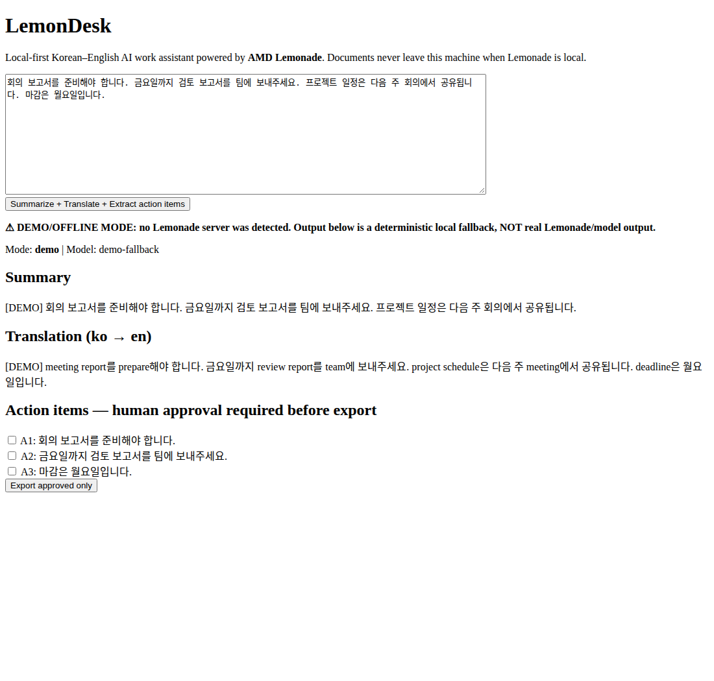
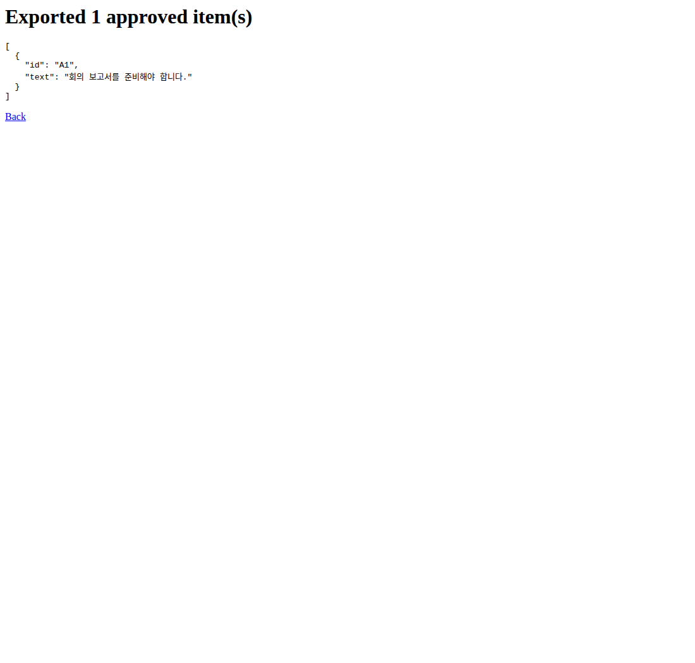

# LemonDesk — AMD Lemonade 기반 로컬 우선 한·영 AI 업무 어시스턴트

> 한국어 또는 영어 업무 문서를 붙여넣으면 요약, 한↔영 번역, 액션 아이템 추출을 모두 **로컬에서** AMD Lemonade로 수행합니다. 그리고 사람이 승인하기 전에는 아무것도 내보내지 않습니다.

🌐 **English README:** [README.md](README.md)

## 영감 (Inspiration)

한국의 지식 노동자는 내부 회의 문서를 받고 AI가 잘하는 세 가지를 원합니다 — 요약, 글로벌 동료를 위한 영어 번역, 액션 아이템 정리. 그런데 바로 그 문서가 클라우드 AI에 붙여넣으면 안 되는 문서입니다. 출발점의 가설은 "사람들에게는 더 좋은 번역기가 필요하다"였습니다. 우리는 다른 가설을 택해 만들었습니다: 사람들에게 필요한 것은 요약–번역–추출의 **전체 루프가 자기 컴퓨터에서 도는 것**, 그리고 기계가 추출한 업무가 조용히 내보내진 업무가 되지 않는다는 보장입니다. 이 두 번째 가설은 **사용자 조사의 결과가 아니라 설계상의 베팅**입니다 — 아직 사용자 인터뷰가 뒷받침하지 않으며, 실제 사용자로 검증하는 일은 명시적으로 남은 과제입니다(아래 Challenges 참조).

## 숫자로 보는 문제 (출처를 단 통계만)

- **이 프로젝트가 막으려는 바로 그 사고가 이미 한국에서 일어났습니다.** 2023년 삼성전자 엔지니어들이 소스 코드와 회의록 등 민감한 내부 자료를 ChatGPT에 올렸고, 삼성전자는 2023년 5월 1일부터 회사 기기에서 생성형 AI 도구 사용을 제한하고, 번역과 문서 요약을 위한 자체 도구를 개발하는 것으로 대응했습니다. 출처: *The Korea Herald*, "Samsung bans use of generative AI tools like ChatGPT after April internal data leak" (2023) — https://www.koreaherald.com/article/3118116
- **근로자들은 실제로 민감한 자료를 공개 AI에 붙여넣습니다.** 47개국 32,352명을 대상으로 한 글로벌 연구에서, AI를 사용하는 근로자의 48%가 민감한 회사 정보나 고객 정보를 공개 생성형 AI 도구에 업로드한 적이 있다고 답했습니다. 출처: Gillespie et al., *Trust, attitudes and use of artificial intelligence: A global study* (KPMG / 멜버른대학교, 2025), TechXplore 보도 — https://techxplore.com/news/2025-04-major-survey-people-ai-regularly.pdf
- **내부 데이터가 새어 나가면 비용이 큽니다.** IBM의 *Cost of a Data Breach Report 2024*는 데이터 유출의 전 세계 평균 비용을 **488만 달러(USD 4.88 million)**로 제시했습니다(604개 조직 조사). 출처: IBM, *Cost of a Data Breach Report 2024* — https://www.ibm.com/think/insights/whats-new-2024-cost-of-a-data-breach-report

세 사례의 공통점: 내부 문서에 대한 AI 도움 수요는 실재하고, 클라우드 경유는 위험이며, 한국의 대표 기업은 금지 + 자체 도구로 답했습니다. LemonDesk는 그 답의 오픈소스·내 PC 실행 버전입니다.

## 대상 사용자

**내부 문서를 클라우드 AI로 보낼 수 없는 한국 지식 노동자** — 내부 보고서, 회의록, 한·영 이중 언어 업무 문서를 자기 PC에서 다루는 직장인입니다. 의도적으로 만들지 않은 것: 클라우드 동기화 서비스, 액션 아이템을 어딘가로 자동 전송·게시하는 기능, 범용 챗봇. 기능 수보다 집중을 택했습니다.

## 무엇을 하는가

1. **Lemonade 탐지** — Lemonade 헬스 엔드포인트와 `GET /api/v1/models`를 확인하고 사용 가능한 모델을 나열합니다(`--check`).
2. **문서 처리** (CLI 또는 웹 UI) — 요약, 한→영 또는 영→한 번역(방향 자동 감지), 액션 아이템 추출.
3. **사람 승인 게이트** — 액션 아이템은 표시만 되고, 사람이 특정 항목 ID를 승인하기 전에는 **내보내지 않습니다**. 내보내기는 게이트 뒤의 결정적 코드가 하며, 모델이 결정하지 않습니다.
4. **감사 로그** — 모든 모델 호출이 JSONL 감사 로그에 기록됩니다: 타임스탬프, 모델, 작업별 모드(`real`/`demo`), SHA-256 프롬프트 해시(프롬프트 원문이 아님), 지연 시간. 실행 전체의 모드는 각 작업이 실제로 한 일에서 도출됩니다: `real`(전부 Lemonade 처리), `demo`(서버 없음), `mixed`(일부 작업이 폴백 — 결과에 그렇게 표시하고 어떤 작업인지 명시).

## Lemonade 활용 방식 — 장식이 아니라 추론 루프 안에

Lemonade는 세 가지 추론 단계 모두의 추론 엔진입니다. 서버에 연결되면 **각 단계는 작업 전용 프롬프트를 가진 별도의 Lemonade 채팅 완성 호출**(`POST /api/v1/chat/completions`, OpenAI 호환)이며, 각 호출은 출력이 사용되기 전에 감사 로그에 기록됩니다:

```
문서 ─► [Lemonade chat: 요약]     ─► 요약
     ─► [Lemonade chat: 번역]     ─► 번역
     ─► [Lemonade chat: 추출]     ─► 액션 아이템 ─► ApprovalGate (사람) ─► 내보내기 (승인된 것만)
모든 호출 ─► audit.jsonl (타임스탬프, 모델, 모드, 프롬프트 해시, 지연 시간)
```

**경계 선언: 모델은 무엇이 내보내질지 절대 결정하지 않습니다.** 모델은 액션 아이템을 *제안*할 수만 있고, 내보내기는 결정적 코드(`ApprovalGate.export()`)만이 하며, 사람이 승인한 항목만 내보냅니다. 테스트로 증명됨: 승인 0건 = 내보내기 0건.

**생성자와 독립된 검증:** 테스트 스위트는 동일한 OpenAI 호환 엔드포인트를 구현한 *별도의 가짜 Lemonade 서버*(테스트 더블)에 대해 워크플로를 실행하고 출력, 모델명, 모드, 정확히 3행의 감사 로그를 검증합니다 — 만드는 코드와 검사하는 코드는 다릅니다.

## 어떻게 만들었는가 (How we built it)

- **의존성 제로 Python.** 클라이언트, 워크플로, CLI, 웹 UI, 감사 로그까지 전체 앱이 Python 3 표준 라이브러리만으로 만들어졌습니다(`urllib`, `http.server`, `hashlib`, `unittest`). `pip install`할 것이 없습니다. 한 번에 끝까지 감사할 수 없는 개인정보 도구는 그만큼 약한 도구이기 때문입니다. 소스 구성: `src/lemondesk/client.py`(Lemonade API 클라이언트), `workflow.py`(파이프라인 + 승인 게이트), `demo.py`(결정적 오프라인 폴백), `audit.py`(JSONL 감사 로그), `cli.py`와 `server.py`(두 프런트엔드).
- **하나가 아니라 세 번의 호출.** 각 추론 단계가 작업 전용 프롬프트를 가진 별도 호출이라, 단계별 모드·모델·지연 시간을 개별적으로 감사할 수 있고, 한 단계의 실패가 거대한 단일 프롬프트 속에 묻히지 않고 드러납니다.
- **게이트는 프롬프트가 아니라 코드.** `ApprovalGate.export()`는 사람이 승인한 ID 집합으로 필터링합니다. 웹 UI는 독립 평가 이후 강화됐습니다: 내보낼 수 있는 항목은 서버가 직접 실행한 `/process` 결과가 쓴 서버 측 상태에만 존재하므로, 브라우저가 게이트가 승인할 항목을 지어낼 수 없습니다(회귀 테스트 있음).
- **가짜 서버를 중심으로 한 테스트 우선 개발.** 제작 머신에 Lemonade 서버가 없어, 저장소 안의 충실한 테스트 더블이 Lemonade의 `/health`, `/models`, `/chat/completions` 엔드포인트를 구현합니다. 실제 모드 전체 워크플로, 의도적으로 불안정한 서버(혼합 모드 라벨링용), 웹 UI의 내보내기 신뢰 모델이 모두 이 더블로 테스트됩니다.

## 데모 / 오프라인 모드 (정직한 라벨링)

Lemonade 서버가 탐지되지 않으면 LemonDesk는 명확히 라벨링된 **데모/오프라인 모드**로 동작합니다: 결정적 로컬 폴백(추출식 요약, 고정 용어집 번역, 마커 기반 액션 아이템 추출). 모든 데모 출력에는 `[DEMO]` 접두사가 붙고, CLI/UI는 "실제 Lemonade/모델 출력이 아님"을 표시하며, 감사 행에는 `mode: "demo"`가 기록됩니다. 데모 출력이 모델 출력으로 제시되는 일은 없습니다. 이 모드는 심사자가 승인 게이트와 감사 로그를 포함한 전체 워크플로를 어떤 머신에서든 재현하고 동일한 결과를 얻을 수 있게 하기 위해 존재합니다(폴백은 결정적이고, 테스트가 이를 검증합니다).

**혼합 모드:** Lemonade 서버가 일부 작업에만 답하고 나머지에 실패하면, 실행은 `mode: "mixed"`로 보고되고, 화면 공지가 폴백한 작업을 명시하며, 그 출력은 `[DEMO]` 라벨을 유지하고, 감사 로그의 작업별 모드는 결과의 주장과 일치합니다. 부분적으로 폴백한 실행이 완전히 실제인 것처럼 꾸며지는 일은 없습니다. (이 라벨링은 독립 평가가 원래 코드가 바로 이 상황에서 순수 `real` 모드를 주장하는 것을 잡아낸 뒤에 추가됐습니다.)

## 스크린샷 — 실제 캡처, 데모 모드

2026-11-25에 동봉된 한국어 샘플을 실행하면서 웹 UI의 실제 응답을 헤드리스 Chromium으로 렌더링해 캡처했습니다(데모 모드 — 캡처 머신에 Lemonade 서버가 없으며, 화면에도 그렇게 표시됩니다):

| 처리 / 결과 화면 | 내보내기 화면 |
|---|---|
|  |  |

입력 폼은 [docs/screenshots/01-home.png](docs/screenshots/01-home.png)입니다. 결과 화면의 액션 아이템 **A2 — "금요일까지 검토 보고서를 팀에 보내주세요"**를 보세요 — 데모 추출기가 원래 놓쳤던 bare-주세요 요청이 수정 후 추출된 것입니다. 내보내기 화면은 승인된 항목 정확히 1개(A1)만 보여줍니다.

## 실행 방법

요구 사항: Python 3.10+ 뿐입니다. **서드파티 의존성 제로**(표준 라이브러리만).

```bash
# 실제 Lemonade 서버를 로컬에서 실행 중인 경우: 먼저 Lemonade를 설치·시작하세요
# (OS별 방법은 https://lemonade-server.ai 참조). OpenAI 호환 API는 기본적으로
# http://localhost:13305/api/v1 에서 대기합니다.
export PYTHONPATH=src
python3 -m lemondesk.cli --check                       # 서버 탐지 + 모델 목록
python3 -m lemondesk.cli --file examples/sample-ko.txt # 연결되면 실제 추론

# 데모 모드 (서버 불필요 — 출력에 DEMO 라벨):
python3 -m lemondesk.cli --file examples/sample-ko.txt

# 승인 + 내보내기 (사람의 단계 — 승인한 ID만 내보내짐):
python3 -m lemondesk.cli --file examples/sample-ko.txt --approve A1 --export approved.json

# 웹 UI:
python3 -m lemondesk.server --port 8765                # http://127.0.0.1:8765

# Lemonade 주소 변경:
LEMONADE_BASE_URL=http://localhost:13305/api/v1 python3 -m lemondesk.cli --check
```

## 테스트 — 실제 결과

```bash
python3 -m unittest discover -s tests -v
# Ran 22 tests — OK  (2026-11-25 측정, Python 3.12.3; 패키징 전 클린 복사본에서 재실행. 소요 시간은 README.md 참조)
```

22개 테스트는 원래 13개가 다루던 것 — 데모 결정성과 라벨링, 한/영 언어 감지, 한+영 액션 추출, 승인 게이트(승인 0건 → 내보내기 0건; 부분 승인; 모르는 ID 거부), 감사 로그 내용/해시/모드 검증, 가짜 Lemonade 서버 대상 헬스+모델 확인, 실제 모드 전체 워크플로(감사 3행, 전부 `real`), 오프라인 폴백 라벨링, 빈 문서 거부 — 에 **독립 평가 이후 추가된 회귀 테스트 9개**를 더한 것입니다: 의도적으로 불안정한 서버에 대한 혼합 모드 라벨링(결과 모드, 작업별 모드, 감사 모드가 일치해야 함), 웹 내보내기 신뢰(서버 측 처리 없이 내보내기 거부; 위조 항목 ID 거부; 클라이언트가 POST한 항목 텍스트는 무시하고 서버 측 항목 사용), 우아한 CLI 오류(빈 문서와 모르는 `--approve` ID는 트레이스백 없이 명확한 메시지와 함께 종료), 빈 웹 제출에 대한 HTTP 400 페이지(연결 끊김이 아님), 동봉 샘플을 포함한 bare-주세요 추출, 클라이언트 모델 목록 캐싱(반복 채팅에도 `/models` 요청 1회). 2026-11-25에는 실제 CLI 데모 실행과 웹 UI 캡처 세션도 수행했습니다: 서버 확인은 "NOT REACHABLE"을 정확히 보고했고, 데모 실행은 감사 3행(`mode: "demo"`)을 만들었으며, `A1`만 승인하자 정확히 1개 항목이 내보내졌습니다.

## 도전과 한계 — 숨기지 않고 공개

- **이 제작 환경에서는 실제 Lemonade 하드웨어로 실행한 적이 없습니다.** 제작 머신에 Lemonade 서버가 없어(위의 `--check` 탐지가 이를 확인합니다), 실제 모드 동작은 Lemonade의 OpenAI 호환 엔드포인트를 충실히 구현한 가짜 서버로 증명됐을 뿐, 물리적 Ryzen AI 머신으로는 검증되지 않았습니다. 이 프로젝트의 가장 큰 미해결 약점입니다.
- **데모 번역은 의도적으로 약합니다** — `[DEMO-untranslated]` 마커를 쓰는 10단어 고정 용어집입니다. 번역 품질이 아니라 파이프라인을 보여주는 것입니다. 실제 번역 품질은 전적으로 Lemonade가 제공하는 모델에 달려 있습니다.
- **액션 아이템 추출 품질은 실제 모드에서 모델에 의존합니다.** 추출된 항목이 틀릴 수 있기 때문에 승인 게이트가 존재합니다 — 무엇이 내보내지는지에 대한 책임은 사람에게 남습니다.
- **외부 사용자나 매출은 주장하지 않습니다.** 제시하는 증거는 작고 실제입니다: 통과한 자동화 테스트 22개, 재현 가능한 결정적 데모, 실제 UI 스크린샷, 검증된 감사 기록 — 합성된 것을 실제 사용으로 제시하지 않습니다.
- **설계 가설은 검증되지 않았습니다.** 아직 어떤 한국 지식 노동자도 LemonDesk를 써 보고 반응한 적이 없습니다. "더 좋은 번역기가 아니라 로컬로 도는 루프가 필요하다"는 베팅은 틀릴 수 있고, 실제 테스터만이 이를 가릴 수 있습니다.
- 단일 사용자, 로컬 파일 전용. 다중 사용자 인증 없음, 이 버전에서는 UTF-8 일반 텍스트 외 문서 형식 미지원.
- **제출 후 보완 (숨기지 않고 공개):** AMD 제출 이후, 독립 적대 평가가 이 출품작을 프로젝트 자체 품질 체크리스트 기준으로 **58/100 (FAIL)** 으로 채점했습니다 — 주된 이유는 증거 부족(스크린샷 없음, 문제 규모 근거 없음, 실제 하드웨어 데모 없음)과, 직접 찔러 보며 찾아낸 실제 버그 4개(혼합 모드 오표기, 위조 가능한 웹 내보내기 경로, 잘못된 입력에 대한 처리되지 않은 트레이스백, bare-주세요 요청을 놓치는 데모 추출기)였습니다. 네 버그와 코드 저장소가 닫을 수 있는 증거 공백은 이후 회귀 테스트와 함께 수정됐고(그래서 테스트 13개 → 22개), 실제 스크린샷과 위의 출처 있는 통계가 추가됐습니다. 저장소만으로 닫을 수 없는 공백 — 실제 Ryzen AI 하드웨어 실행과 실제 사용자 — 은 위에 그대로 공개돼 있습니다.

## 자랑스러운 성과 (Accomplishments)

- **의존성 제로로 완성된 로컬 우선 루프** — 저장소를 클론하면 요약–번역–추출–승인–내보내기 전체 워크플로가 Python 3.10+가 있는 어떤 머신에서도 돕니다. 실제 Lemonade가 있으면 그걸로, 없으면 정직하게 라벨링된 데모 모드로.
- **적대적 검사를 견딘 안전장치 — 그 검사에 의해 수리된 뒤에.** 승인 게이트의 핵심 성질(승인 0건 = 내보내기 0건)은 CLI 경로에서 독립 테스트를 견뎠고, 웹 경로와 모드 라벨링이 부족하다고 지적된 곳은 약속이 아니라 코드로 수정돼 회귀 테스트로 고정됐습니다.
- **기능으로서의 정직함, 외부에서 검증됨.** 독립 평가자가 이 README의 모든 정량 주장을 재실행해 지어낸 숫자가 없음을 확인했습니다. 같은 평가의 58/100 FAIL 판정은 묻어 두지 않고 Challenges에 공개돼 있고, 이 README는 그 원인이었던 증거(인용, 스크린샷, 실제 테스트 22개)를 이제 갖추고 있습니다.

## AMD 심사 기준에 비추어

챌린지는 **커뮤니티 영향력, 기술적 깊이와 품질, 창의성**의 세 가지 심사 기준을 제시하며, 가중치는 공개하지 않았습니다. 각 기준에 대한 정직한 근거입니다:

- **커뮤니티 영향력.** LemonDesk는 로컬 AI 생태계에서 이름 붙은, 아직 충분히 다뤄지지 않은 틈새 — 한국 지식 노동자 — 를 겨냥하고, 우리가 통제할 수 있는 도입 장벽을 모두 제거했습니다: MIT 라이선스, 의존성 제로, 계정 없음, 클라우드 없음, 이중 언어 문서(이 README), 그리고 지원되는 GPU/NPU가 없는 머신을 포함해 어떤 하드웨어에서도 전체 워크플로를 평가할 수 있는 결정적 데모 모드. 감사 로그와 승인 게이트 패턴은 민감한 문서를 다루는 어떤 Lemonade 앱에서도 재사용할 수 있습니다. *정직한 한계:* 영향력은 아직 측정된 것이 아니라 잠재적인 것입니다 — 외부 사용자는 아직 없으며, 있다고 주장하지 않습니다.
- **기술적 깊이와 품질.** Lemonade는 배지가 아니라, 각각 별도의 프롬프트와 별도의 감사를 받는 세 작업의 추론 엔진입니다. 품질은 형용사가 아니라 산출물로 논증합니다: 자동화 테스트 22개(독립 가짜 서버 종단 간 실행, 불안정 서버 혼합 모드 테스트, 내보내기 위조 테스트 포함), 구조적인(프롬프트가 아닌) 승인 게이트, 호출별 감사 로깅, 그리고 외부 평가자가 찾은 모든 버그를 재현·수정·회귀 테스트한 제출 후 보완 사이클. *정직한 한계:* 시스템은 의도적으로 작고(표준 라이브러리 Python 약 700줄), Ryzen AI 하드웨어의 실제 Lemonade 서버로는 아직 실행되지 않았습니다.
- **창의성.** 창의적인 단계는 세상에서 가장 흔한 LLM 워크플로 — 요약, 번역, 추출 — 를 생성 문제가 아니라 *책임* 문제로 재구성한 것입니다: 모델이 제안하고, 결정적 코드가 처리하고, 사람이 승인하고, 모든 호출이 기록되며, 부분적으로만 사용 가능한 로컬 서버라는 지저분한 현실을 위한 정직한 `mixed` 모드가 있습니다. 한↔영 내부 문서라는 각도, 재현 장치로서의 `[DEMO]` 라벨 결정적 폴백, "모델이 절대 하면 안 되는 것"을 대표 기능으로 내세운 점이 이 프로젝트의 독창적 기여입니다.

## 배운 것 (What we learned)

로컬 추론이 개인정보 대화를 바꾸는 것은, 그 주변 워크플로까지 로컬이고 책임 소재가 분명할 때뿐입니다: 감사되지 않는 로컬 모델도 여전히 블랙박스입니다. 시스템을 "LLM이 제안 / 결정적 코드가 처리 / 사람이 승인 / 모든 것이 기록됨"으로 나누자 로컬이라는 주장이 비로소 신뢰할 만해졌고, 전체를 GPU 없이 테스트할 수 있게 됐습니다.

## 다음 단계 (What's next)

실제 Ryzen AI Max+ 395 머신에서 실행하고 벤치마크하기(작업별 tokens/sec와 지연 시간을 정직하게 공개), .docx/.md 입력 추가, Lemonade를 탐지·설치하는 원클릭 인스톨러, 같은 승인 게이트 뒤에 남는 내보내기 대상(Markdown 체크리스트, 캘린더) 추가. 더 큰 단계: 같은 로컬 우선·승인 게이트 패턴은 "이 머신을 절대 떠나지 않는 것"이 곧 기능인 다른 민감한 이중 언어 사무 작업 — 계약서, HR 문서, 지원 티켓 — 으로 일반화됩니다.

## 사용 기술 (Built with)

- **AMD Lemonade** — 로컬 추론 서버, OpenAI 호환 API(`/api/v1/chat/completions`, `/api/v1/models`, 헬스) — 세 작업 모두의 추론 엔진
- **Python 3 표준 라이브러리만** — `urllib`, `http.server`, `hashlib`, `unittest` (서드파티 의존성 제로)
- 표준 라이브러리 서버가 제공하는 HTML 폼 UI (프레임워크 없음)

## 라이선스

MIT — [LICENSE](LICENSE) 참조.
