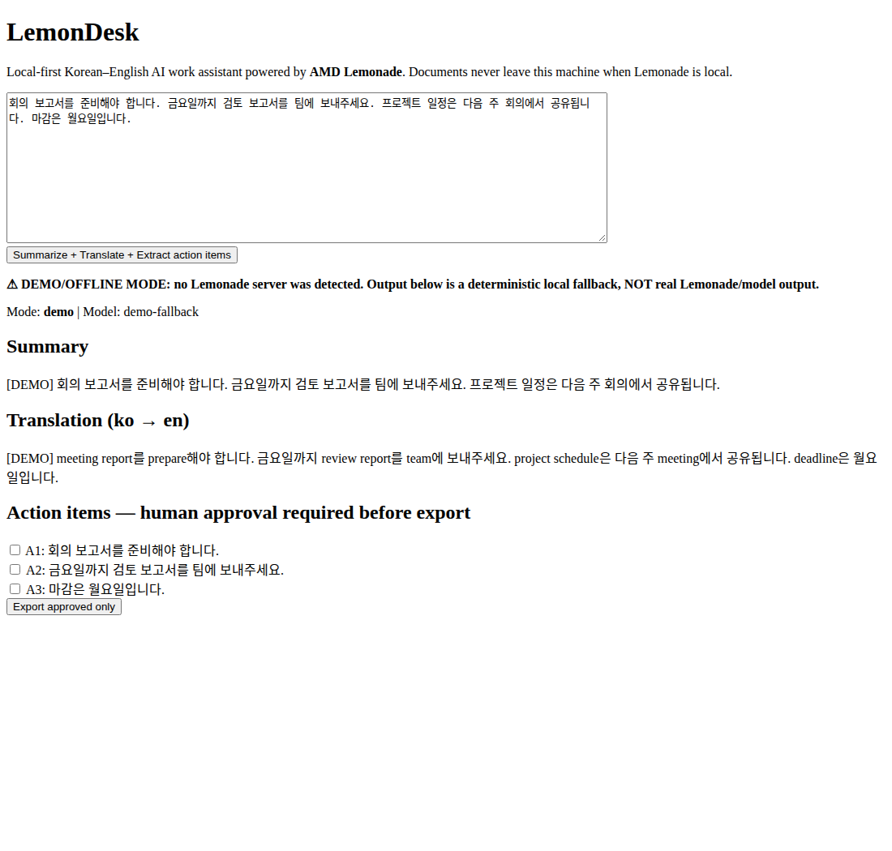
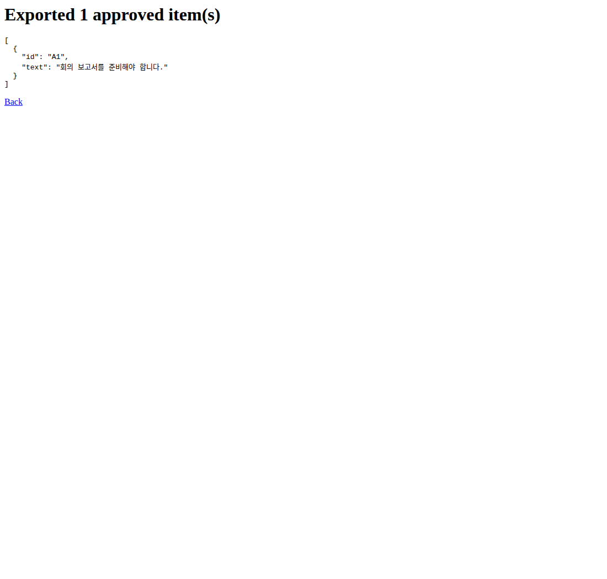

# LemonDesk — Local-first Korean–English AI work assistant powered by AMD Lemonade

> Paste a Korean or English work document. Get a summary, a KO↔EN translation, and extracted action items — all inferred **locally** by AMD Lemonade, and nothing is exported until a human approves it.

🌐 **한국어 README:** [README.ko.md](README.ko.md)

## Inspiration

A Korean knowledge worker receives an internal meeting document and wants three things AI is good at — a summary, an English translation for a global teammate, and the action items. The obvious tools are cloud AIs, and the obvious problem is the document itself: internal documents are exactly the ones that should not be pasted into a cloud service. Our starting hypothesis was "people need a better translator." We chose to build against a different one: people need the *whole* summarise–translate–extract loop to run **on their own machine**, with a guarantee that machine-extracted tasks do not silently become exported work items. That second hypothesis is a **design bet, not a user-research finding** — no user interviews stand behind it yet, and validating it with real users is explicitly still to do (see Challenges). Unlike pasting the document into a cloud chatbot or translation service (ChatGPT- or DeepL-class tools), LemonDesk never sends the document anywhere — every step runs on your own machine through your local Lemonade server, and nothing is exported until you approve it.

## The problem, in numbers (cited, not invented)

- **The exact accident this project exists to prevent already happened in Korea.** In 2023, Samsung Electronics engineers uploaded sensitive internal material — source code and meeting minutes — to ChatGPT; Samsung responded by restricting generative-AI tools on company devices from 1 May 2023 and building in-house tools for translation and document summarisation instead. Source: *The Korea Herald*, "Samsung bans use of generative AI tools like ChatGPT after April internal data leak" (2023) — https://www.koreaherald.com/article/3118116
- **Workers really do paste sensitive material into public AI.** In a global study of 32,352 workers across 47 countries, 48% of employees who use AI said they had uploaded sensitive company or customer information into public generative-AI tools. Source: Gillespie et al., *Trust, attitudes and use of artificial intelligence: A global study* (KPMG / University of Melbourne, 2025), reported by TechXplore — https://techxplore.com/news/2025-04-major-survey-people-ai-regularly.pdf
- **When internal data does escape, it is expensive.** IBM's *Cost of a Data Breach Report 2024* put the global average cost of a data breach at **USD 4.88 million**, based on 604 organisations studied. Source: IBM, *Cost of a Data Breach Report 2024* — https://www.ibm.com/think/insights/whats-new-2024-cost-of-a-data-breach-report

The pattern in all three: the demand for AI help with internal documents is real, the cloud route is the risk, and at least one major Korean employer answered with a ban plus an in-house tool. LemonDesk is the open-source, runs-on-your-own-PC version of that answer.

## Named audience

**Korean knowledge workers who cannot send internal documents to cloud AI** — employees handling internal reports, meeting notes, and bilingual (KO/EN) work documents on their own PCs. Deliberately out of scope (what we chose *not* to build): a cloud sync service, automatic sending/posting of action items anywhere, and a general chatbot. Focus over feature count.

## What it does

1. **Detects Lemonade** — probes the Lemonade health endpoint and `GET /api/v1/models`, lists available models (`--check`).
2. **Processes a document** (CLI or web UI) — summary, KO→EN or EN→KO translation (direction auto-detected), and extracted action items.
3. **Human approval gate** — action items are displayed but **not exported** until a human approves specific item IDs. Export is deterministic code behind the gate, never a model decision.
4. **Audit log** — every model call is appended to a JSONL audit log: timestamp, model, per-task mode (`real`/`demo`), SHA-256 prompt hash (not the prompt text), and latency. A run's overall mode is derived from what each task actually did: `real` (all tasks served by Lemonade), `demo` (no server), or `mixed` (some tasks fell back — the result says so and names them; see Demo / offline mode).

## How Lemonade is used — inside the reasoning loop, not as decoration

Lemonade is the inference engine for all three reasoning steps. When a server is reachable, **each step is a separate Lemonade chat completion** (`POST /api/v1/chat/completions`, OpenAI-compatible) with its own task-specific prompt, and each call is audit-logged before its output is used:

```
document ─► [Lemonade chat: summarize] ─► summary
         ─► [Lemonade chat: translate] ─► translation
         ─► [Lemonade chat: extract]   ─► action items ─► ApprovalGate (human) ─► export (approved only)
every call ─► audit.jsonl (timestamp, model, mode, prompt hash, latency)
```

**Boundary declaration: the model never decides what gets exported.** The model may *propose* action items; only deterministic code (`ApprovalGate.export()`) releases items, and only those a human approved. Test-proven: 0 approvals = 0 exported items.

**Verification, independent of the generator:** the test suite runs the workflow against a *separate fake Lemonade server* (a test double implementing the same OpenAI-compatible endpoints) and asserts the outputs, model name, mode, and exactly 3 audit rows — the producer and the checker are different code.

## How we built it

- **Zero-dependency Python.** The whole app — Lemonade client, workflow, CLI, web UI, audit log — is Python 3 standard library only (`urllib`, `http.server`, `hashlib`, `unittest`). There is nothing to `pip install`, which is deliberate: a privacy tool you cannot audit end-to-end in one sitting is a weaker privacy tool. Source layout: `src/lemondesk/client.py` (Lemonade API client), `workflow.py` (pipeline + approval gate), `demo.py` (deterministic offline fallback), `audit.py` (JSONL audit log), `cli.py` and `server.py` (the two front ends).
- **Three calls, not one.** Each reasoning step is its own Lemonade chat completion with a task-specific prompt, so each step's mode, model, and latency are individually auditable — and so a failure in one step is visible instead of smeared across a single mega-prompt.
- **The gate is code, not a prompt.** `ApprovalGate.export()` filters by a set of human-approved IDs. The web UI was hardened after independent review: exportable items live only in server-side state written by the server's own `/process` run, so a browser cannot invent items for the gate to approve (regression-tested).
- **Built test-first around a fake server.** Because the build machine has no Lemonade server, a faithful in-repo test double implements Lemonade's `/health`, `/models`, and `/chat/completions` endpoints; the full real-mode workflow, a deliberately flaky server (for mixed-mode labelling), and the web UI's export trust model are all exercised against it in the test suite.

## Demo / offline mode (honest labelling)

If no Lemonade server is detected, LemonDesk runs in a clearly labelled **DEMO/OFFLINE mode**: a deterministic local fallback (extractive summary, fixed-glossary translation, marker-based action extraction). Every demo output is prefixed `[DEMO]`, the CLI/UI prints "NOT real Lemonade/model output", and audit rows record `mode: "demo"`. Demo output is never presented as model output. This exists so reviewers can reproduce the full workflow — including the approval gate and audit log — on any machine, and get identical results (the fallback is deterministic; tests assert this).

**Mixed mode:** if a Lemonade server answers some tasks but fails others, the run reports `mode: "mixed"`, the on-screen notice names the tasks that fell back, their output keeps its `[DEMO]` labelling, and the audit log's per-task modes match what the result claims. A partially-fallen-back run is never dressed up as fully real. (This labelling was added after an independent evaluation caught the original code claiming pure `real` mode in exactly this situation.)

## Screenshots — real captures, demo mode

Captured 2026-11-25 with headless Chromium rendering the web UI's actual responses while running the bundled Korean sample (demo mode — no Lemonade server on the capture machine, and the screens say so):

| Process / result screen | Export screen |
|---|---|
|  |  |

The input form is [docs/screenshots/01-home.png](docs/screenshots/01-home.png). Note the result screen's action item **A2 — "금요일까지 검토 보고서를 팀에 보내주세요"** — the bare-주세요 request the demo extractor originally missed, extracted after the fix. The export screen shows exactly the one approved item (A1) and nothing else.

## Real-server benchmark — 2026-11-26

The full workflow has now run against a **real Lemonade server** (Lemonade 2026.48.3, Qwen3-4B-GGUF, llamacpp/CUDA on an NVIDIA Tesla T4 in a free cloud GPU runtime): **every run in `mode: real`, zero demo fallbacks**, ≈48–50 tokens/s server-side, and the approval gate exporting exactly the one approved item end-to-end. Full numbers, environment disclosure, and raw audit evidence: [docs/BENCHMARK-RESULT.md](docs/BENCHMARK-RESULT.md). This is a cloud-GPU run, **not** a Ryzen AI benchmark — that run is still outstanding and will be published the same way.

## How to run

Requirements: Python 3.10+ only. **Zero third-party dependencies** (standard library only).

```bash
# With a real Lemonade server running locally: install/start Lemonade first
# (see https://lemonade-server.ai for your OS); its OpenAI-compatible API
# listens on http://localhost:13305/api/v1 by default.
export PYTHONPATH=src
python3 -m lemondesk.cli --check                       # detect server + list models
python3 -m lemondesk.cli --file examples/sample-ko.txt # real inference when reachable

# Demo mode (no server needed — output is labelled DEMO):
python3 -m lemondesk.cli --file examples/sample-ko.txt

# Approve + export (human step — only approved IDs are exported):
python3 -m lemondesk.cli --file examples/sample-ko.txt --approve A1 --export approved.json

# Web UI:
python3 -m lemondesk.server --port 8765                # http://127.0.0.1:8765

# Custom Lemonade address:
LEMONADE_BASE_URL=http://localhost:13305/api/v1 python3 -m lemondesk.cli --check

# Real-hardware benchmark (needs a live Lemonade server):
python3 tools/benchmark.py   # writes a BENCHMARK-RESULT.md from the audit log
```

## Tests — real results

```bash
python3 -m unittest discover -s tests -v
# Ran 29 tests in 4.289s — OK  (measured 2026-11-26, Python 3.12.3, from a clean copy with __pycache__ removed)
```

29 tests cover everything the original 13 did — demo determinism and labelling, KO/EN language detection, KO+EN action extraction, approval gate (0 approvals → 0 exported; partial approval; unknown ID rejected), audit log contents/hash/mode validation, health+models against a fake Lemonade server, the full workflow in real mode (3 audit rows, all `real`), offline fallback labelling, and empty-document rejection — **plus 13 regression tests added after independent evaluation**: mixed-mode labelling against a deliberately flaky server (result mode, per-task modes, and audit modes must agree), web export trust (export without a prior server-side process is rejected; forged item IDs are rejected; client-POSTed item text is ignored in favour of server-side items), graceful CLI errors (empty document and unknown `--approve` ID exit with a clear message, no traceback), an HTTP 400 page (not a dropped connection) for an empty web submission, bare-주세요 extraction including the bundled sample, and model-list caching in the client (one `/models` request across repeated chats) — **plus 4 more after the round-2 re-evaluation**: an empty `--file` now reports "document text is empty" instead of a misleading usage error, and the approval gate is defensive in-process (items are copied on construction and the approved set is read-only, so mutation probes cannot change what export releases) — **plus 3 real-server compatibility tests added 2026-11-26**: chat generation uses its own 300 s timeout (a slow fake server that outlasts the 0.3 s probe timeout still completes), and model lists in the current Lemonade `model_name` shape are parsed correctly. A live CLI demo run and the web-UI capture session were also executed on 2026-11-25: server check correctly reported "NOT REACHABLE", the demo run produced 3 audit rows (`mode: "demo"`), and approving only `A1` exported exactly 1 item. On 2026-11-26 the same CLI flow ran against a real Lemonade server in `mode: real` (see the benchmark section above).

## Challenges / limitations — disclosed, not hidden

- **Real-mode execution: proven against a real server (2026-11-26); a Ryzen AI run is still outstanding.** The full workflow ran in `mode: real` against Lemonade 2026.48.3 serving Qwen3-4B-GGUF (llamacpp/CUDA) on a cloud GPU — see [docs/BENCHMARK-RESULT.md](docs/BENCHMARK-RESULT.md). That closes the original "never executed against real Lemonade" weakness, but it is **not** a Ryzen AI / NPU benchmark: performance on AMD hardware remains unmeasured, and claiming otherwise would be exactly the kind of overstatement this project refuses to make.
- **Demo translation is intentionally weak** — a 10-word fixed glossary with `[DEMO-untranslated]` markers. It demonstrates the pipeline, not translation quality. Real translation quality depends entirely on the Lemonade-served model.
- **Action-item extraction quality is model-dependent** in real mode; the approval gate exists precisely because extracted items can be wrong — a human remains accountable for what gets exported.
- **No external users or revenue are claimed.** Proof offered is small and real: 29 passing automated tests, a reproducible deterministic demo, real UI screenshots, a real-server benchmark with raw audit evidence, and a verified audit trail — nothing synthetic is presented as real usage.
- **The design hypothesis is unvalidated.** No Korean knowledge worker has yet run LemonDesk and reacted to it; the "people need the loop local, not a better translator" bet could be wrong, and only real testers can settle it.
- Single-user, local files only; no multi-user auth, no document formats beyond UTF-8 plain text in this version.
- **Post-submission remediation (disclosed, not hidden):** after the AMD submission, an independent adversarial evaluation scored this entry **58/100 (FAIL)** against the project's own quality checklist — chiefly for missing proof (no screenshots, no problem-size evidence, no demo on real hardware) and for four real bugs it found by probing: mixed-mode mislabelling, a forgeable web export path, unhandled tracebacks on bad input, and a demo extractor that missed bare-주세요 requests. The four bugs and the proof gaps that a code repository can close have since been fixed with regression tests (hence 13 → 22 tests), real screenshots, and the cited statistics above. The gaps a repository cannot close — a real Ryzen AI hardware run and real users — remain open above, in plain sight. A second independent re-evaluation then scored the remediated entry **71/100 (still FAIL)**; its remaining in-repo findings have also been applied (the suite is now at 26 tests, the line count below is corrected, and both evaluation reports live in this repo: [EVALUATION.md](EVALUATION.md) and [EVALUATION-2.md](EVALUATION-2.md)) — the rest of its deductions require real hardware, a recorded demo, or real users. **Update 2026-11-26:** the real-hardware item is now half-closed — the workflow ran end-to-end against a real Lemonade server on a cloud GPU (benchmark and raw evidence in [docs/BENCHMARK-RESULT.md](docs/BENCHMARK-RESULT.md)), and that run surfaced two further real-server compatibility bugs (a 5 s chat timeout and the `model_name` field), both fixed with regression tests (suite now 29). Still open: a Ryzen AI hardware run, a recorded demo video, and real users.

## Accomplishments that we're proud of

- **A complete, working local-first loop with zero dependencies** — clone the repo and the full summarise–translate–extract–approve–export workflow runs on any machine with Python 3.10+, against real Lemonade when present and in an honestly labelled demo mode when not.
- **A safeguard that survived adversarial probing — after being repaired by it.** The approval gate's core property (0 approvals = 0 exported) held under independent testing on the CLI path; where probing found the web path and the mode labelling wanting, the fixes are in the code and locked in by regression tests, not just promised.
- **Honesty as a feature, verified from outside.** An independent evaluator re-ran every quantitative claim in this README and found no fabricated numbers; the same evaluation's 58/100 FAIL verdict is disclosed in Challenges rather than buried, and this README now carries the evidence (citations, screenshots, 29 real tests, a real-server benchmark) whose absence caused it. A round-2 re-evaluation of the remediated entry scored it 71/100 — still a FAIL, and also disclosed rather than buried.

## Judged on AMD's criteria

The challenge states three judging criteria — **community impact, technical depth & quality, creativity** — with no published weights. Honest evidence for each:

- **Community impact.** LemonDesk targets a named, underserved niche in the local-AI ecosystem — Korean knowledge workers — and removes every adoption barrier we control: MIT-licensed, zero dependencies, no account, no cloud, bilingual documentation ([README.ko.md](README.ko.md)), and a deterministic demo mode so any community member can evaluate the full workflow on any hardware, including machines with no supported GPU/NPU. Its audit-log and approval-gate pattern is reusable by any Lemonade app that touches sensitive documents. *Honest limit:* impact so far is potential, not measured — there are no external users yet, and we claim none.
- **Technical depth & quality.** Lemonade is the reasoning engine for three separately-prompted, separately-audited tasks — not a badge. Quality is argued with artefacts, not adjectives: 29 automated tests (including an independent fake-server end-to-end run, a flaky-server mixed-mode test, and export-forgery tests), a structural (non-prompt) approval gate, per-call audit logging, a post-evaluation remediation cycle in which every bug an outside reviewer found was reproduced, fixed, and regression-tested, and a 2026-11-26 end-to-end run against a real Lemonade server with published benchmark evidence. *Honest limit:* the system is deliberately small (~490 lines of stdlib Python source, ~830 including the test suite) and its real-server proof so far is a cloud GPU (CUDA) run — a Ryzen AI / NPU run is still outstanding.
- **Creativity.** The creative step is reframing the most generic LLM workflow there is — summarise, translate, extract — as an *accountability* problem instead of a generation problem: the model proposes, deterministic code disposes, a human approves, and every call is logged, with an honest `mixed` mode for the messy reality of a partially-available local server. The KO↔EN internal-document angle, the [DEMO]-labelled deterministic fallback as a reproducibility device, and treating "what the model may never do" as the headline feature are the project's original contributions.

## What we learned

Local inference changes the privacy conversation only if the *workflow around it* is also local and accountable: an unaudited local model is still a black box. Splitting the system into "LLM proposes / deterministic code disposes / human approves / everything is logged" made the local story actually trustworthy — and made the whole thing testable without a GPU.

## What's next

The larger step comes first: the same local-first, approval-gated pattern generalises to other sensitive bilingual office work — contracts, HR documents, support tickets — where "never leaves this machine" is the feature. The feature work that supports that expansion: repeat the benchmark on a real Ryzen AI Max+ 395 machine (the first real-server benchmark — cloud GPU, CUDA — is already published in [docs/BENCHMARK-RESULT.md](docs/BENCHMARK-RESULT.md); benchmarks are produced with [tools/benchmark.py](tools/benchmark.py) in this repo, run against a live Lemonade server on the bundled sample and [tools/sample-long-ko.txt](tools/sample-long-ko.txt)), add .docx/.md input, a one-click installer that detects/installs Lemonade, and export targets (Markdown checklist, calendar) that remain behind the same approval gate.

## Built with

- **AMD Lemonade** — local inference server, OpenAI-compatible API (`/api/v1/chat/completions`, `/api/v1/models`, health) — the reasoning engine for all three tasks
- **Python 3 standard library only** — `urllib`, `http.server`, `hashlib`, `unittest` (zero third-party dependencies)
- HTML form UI served by the stdlib server (no framework)

## License

MIT — see [LICENSE](LICENSE).
